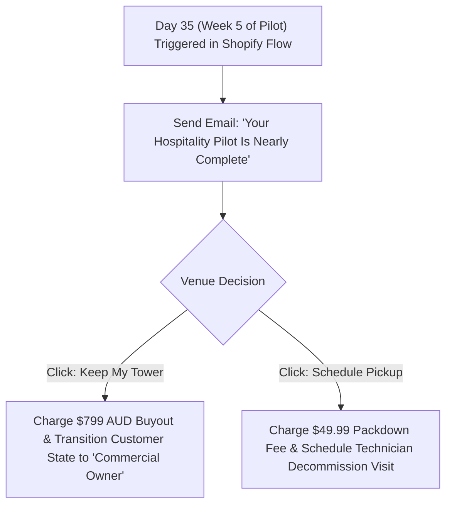

# AeroHarvest Australia — Production Shopify Storefront Technical Implementation Report

**Document Version**: v1.0.0  
**Project**: AeroHarvest Australia (`aeroharvest.com.au`)  
**Date**: September 10, 2026  
**Architecture Baseline**: Online Store 2.0 / Headless React + Shopify Commerce Infrastructure  

---

## 1. Executive Summary & Brand Positioning

AeroHarvest Australia is a premium Australian vertical aeroponic growing platform built around two distinct target markets:
- **B2C (For Your Home)**: *"Grow Up. Not Out. Fresh food doesn't need a huge backyard."*
- **B2B (For Your Business)**: *"Your garnish shouldn't arrive in a plastic box. Grow What You Serve. Harvest What You Need."*

The storefront avoids generic "hydroponics" or cheap eco-branding, presenting a high-tech modern Australian lifestyle visual aesthetic (natural whites, warm neutrals, muted botanical greens, and dark charcoal).

---

## 2. Codebase & Components Inventory

The following files and components were created/updated in `src/`:

### Core Data & Types
- [`src/types/storefront.ts`](file:///c:/Users/sean_/Documents/Green%20Tower/src/types/storefront.ts): TypeScript interfaces for B2C system tiers, B2B pilot and buyout offers, seedling nursery items, intake form submissions, and analytics events.
- [`src/config/storefrontConfig.ts`](file:///c:/Users/sean_/Documents/Green%20Tower/src/config/storefrontConfig.ts): Centralized store configuration, default pricing ($299/$349/$449 B2C base; $399/$449/$549 B2C complete kit; $1,099 B2B RRP; $49.99/wk B2B concierge pilot; $799 pilot graduate buyout; $49.99 return fee), nursery catalog, and compliance statements.

### Components
- [`src/components/Navbar.tsx`](file:///c:/Users/sean_/Documents/Green%20Tower/src/components/Navbar.tsx): Sticky global navigation header with AeroHarvest AUSTRALIA logo, dual-market links, mobile drawer menu, and primary CTA *"Book a Commercial Trial"*.
- [`src/components/SplitMarketHero.tsx`](file:///c:/Users/sean_/Documents/Green%20Tower/src/components/SplitMarketHero.tsx): Homepage split-market hero gateway card separating B2C Home Systems from B2B Venue Hospitality Pilot.
- [`src/components/B2CStorefront.tsx`](file:///c:/Users/sean_/Documents/Green%20Tower/src/components/B2CStorefront.tsx): Comprehensive B2C storefront featuring 6 core pain point motivations, *"You Grew This"* emotional experience, family education, 5/7/11 tier selector, package configurator, hardware material specs, and NASA space research story.
- [`src/components/B2C_ROICalculator.tsx`](file:///c:/Users/sean_/Documents/Green%20Tower/src/components/B2C_ROICalculator.tsx): Interactive household grocery savings and system payback calculator.
- [`src/components/B2BStorefront.tsx`](file:///c:/Users/sean_/Documents/Green%20Tower/src/components/B2BStorefront.tsx): Commercial portal highlighting venue garnish wilt problem visual, 11-tier tower specs, 4-step Concierge Cadence (*"We Keep The System Productive"*), pricing cards, and curated crop collections.
- [`src/components/B2B_ROICalculator.tsx`](file:///c:/Users/sean_/Documents/Green%20Tower/src/components/B2B_ROICalculator.tsx): Venue garnish spend and coolroom waste reduction calculator.
- [`src/components/B2BIntakeForm.tsx`](file:///c:/Users/sean_/Documents/Green%20Tower/src/components/B2BIntakeForm.tsx): Multi-step commercial onboarding application capturing business name, ABN, venue address, crop mix, weekly spend, delivery window, and lighting environment.
- [`src/components/Week5AutomationModal.tsx`](file:///c:/Users/sean_/Documents/Green%20Tower/src/components/Week5AutomationModal.tsx): Interactive preview of Week 5 Hospitality Pilot automation journey ($799 buyout vs $49.99 collection fee).
- [`src/components/SeedlingNursery.tsx`](file:///c:/Users/sean_/Documents/Green%20Tower/src/components/SeedlingNursery.tsx): Dedicated nursery replenishment catalog featuring pre-rooted plant pod bundles with subscription auto-refill toggle.
- [`src/components/FAQ.tsx`](file:///c:/Users/sean_/Documents/Green%20Tower/src/components/FAQ.tsx): Categorized accordion FAQ (B2C, B2B, Nursery, ACL & Electrical Compliance).
- [`src/components/Footer.tsx`](file:///c:/Users/sean_/Documents/Green%20Tower/src/components/Footer.tsx): Responsive footer with ACL guarantee notice, Victoria warehouse dispatch badge, and dual-market conversion links.
- [`src/App.tsx`](file:///c:/Users/sean_/Documents/Green%20Tower/src/App.tsx): View router shell connecting header state, modals, and page views.

---

## 3. Shopify Admin Settings & Configuration Requirements

To complete live Shopify production deployment:

### Required Shopify Settings
1. **Currency**: Set Store Currency to AUD ($ AUD).
2. **Tax**: Enable GST (10%) inclusive pricing for Australian customers.
3. **Shipping & Delivery**:
   - Free Victoria Metro Express Delivery rule.
   - Flat-rate interstate dispatch rates (NSW, QLD, SA, WA, TAS, ACT, NT).
4. **Markets**: Configure Primary Market as **Australia** (AUD).

### Required Shopify Products Catalog Setup
Create the following product handles in Shopify Admin:

| Product Title | Handle | Type | Default RRP |
|---|---|---|---|
| AeroHarvest 5-Section Compact Tower | `aeroharvest-5-section-compact` | Physical Hardware | $299 AUD Base / $399 Complete Kit |
| AeroHarvest 7-Section Standard Tower | `aeroharvest-7-section-standard` | Physical Hardware | $349 AUD Base / $449 Complete Kit |
| AeroHarvest 11-Section Family Powerhouse | `aeroharvest-11-section-family` | Physical Hardware | $449 AUD Base / $549 Complete Kit |
| 11-Tier Commercial AeroHarvest Tower | `aeroharvest-11-tier-commercial` | B2B Commercial | $1,099 AUD Direct RRP |
| 6-Week Hospitality Concierge Pilot | `hospitality-concierge-pilot` | Service Subscription | $49.99 AUD / week (6 cycles) |
| Pilot Graduate Ownership Buyout | `pilot-graduate-buyout` | B2B Buyout | $799 AUD |
| Pilot System Collection & Packdown | `pilot-collection-fee` | B2B Fee | $49.99 AUD |
| Nursery Plant Pod Bundle (4-6 Pack) | `nursery-pod-bundle` | Consumable / Subscription | $24.99 - $34.99 AUD |

---

## 4. Shopify Metafields Schema Definition

Add the following Custom Data Metafields in Shopify Admin under **Settings → Custom Data → Products**:

```json
{
  "namespace": "aeroharvest",
  "metafields": [
    { "key": "tower_tier_count", "type": "integer", "description": "Number of tower sections (e.g. 5, 7, 11)" },
    { "key": "grow_site_count", "type": "integer", "description": "Active planting ports (e.g. 20, 28, 44)" },
    { "key": "tower_height", "type": "single_line_text_field", "description": "Height in meters (e.g. 1.25m, 1.52m, 2.10m)" },
    { "key": "footprint", "type": "single_line_text_field", "description": "Base dimensions (60 x 60 cm)" },
    { "key": "reservoir_capacity", "type": "single_line_text_field", "description": "Water tank volume (38 Litres)" },
    { "key": "pump_type", "type": "single_line_text_field", "description": "Submersible 12V/24V DC pump model" },
    { "key": "pilot_buyout_price", "type": "number_decimal", "description": "Pilot Graduate Buyout Price ($799.00)" },
    { "key": "pilot_service_price", "type": "number_decimal", "description": "Weekly concierge pilot fee ($49.99)" },
    { "key": "nursery_crop_type", "type": "single_line_text_field", "description": "Crop category (Cocktail Herbs, Microgreens, etc.)" },
    { "key": "warranty_information", "type": "multi_line_text_field", "description": "2-Year Australian Hardware Warranty Details" }
  ]
}
```

---

## 5. Subscription Architecture Integration

### Third-Party App Requirement: **Shopify Subscriptions / Recharge / Seal Subscriptions**

#### Technical Requirement:
1. **6-Week Hospitality Pilot**:
   - Frequency: Weekly.
   - Max billing cycles: **6 payments** ($49.99 x 6 = $299.94 AUD).
   - Auto-cancellation trigger: Terminate recurring charge after 6 successful charges.
2. **Seedling Nursery Pod Subscription**:
   - Frequency: Monthly / Bi-monthly.
   - Discount: 15% recurring discount on nursery pod refills.

*Note: Shopify theme frontend handles subscription presentation and option toggling; final recurring charge scheduling relies on a verified subscription app integration.*

---

## 6. Shopify Flow & CRM Week 5 Automation Email Workflow

### Trigger: **Pilot Subscription Reaches Cycle 5 (Day 35)**



---

## 7. Analytics & Conversion Event Catalog

Integrate the following custom DOM event triggers with Google Analytics 4 (GA4), Meta Pixel, or Klaviyo:

### B2C Analytics Events
- `home_gateway_click`: Triggered when user selects B2C from split hero.
- `tower_selection`: Triggered when user selects 5, 7, or 11-tier tower.
- `package_selection`: Triggered when user toggles Base vs Complete Starter Kit.
- `roi_calculator_interaction`: Triggered when user adjusts grocery spend or household size inputs.

### B2B Analytics Events
- `business_gateway_click`: Triggered when user selects B2B from split hero.
- `pilot_cta_click`: Triggered when user clicks *"Start 6-Week Hospitality Pilot"*.
- `pilot_application_submit`: Triggered upon submitting the venue application form.
- `pilot_keep_click`: Triggered when user previews or selects the $799 buyout option.
- `pilot_return_click`: Triggered when user previews or selects the $49.99 return option.

---

## 8. Compliance & Claim Governance Audit

> [!CAUTION]
> **Australian Consumer Law (ACL) Safeguards**:
> 1. **No Unsupported Organic Claims**: Produce is described as *"soilless, clean home growing"* with *"organic-compatible nutrients"*. Do not claim produce is "certified organic" unless full certification documentation is produced.
> 2. **No NASA Endorsement Claims**: NASA's decades of research into aeroponic soilless agriculture is presented strictly as an inspirational science narrative (*"inspired by research into space agriculture"*). Do not claim AeroHarvest is "NASA approved" or "NASA technology".
> 3. **Electrical Safety**: Standard systems run on low-voltage 12V/24V DC power isolation adapters. Compliance claims (RCM/EESS) must only be displayed after independent Australian electrical laboratory test certificates are on file.
> 4. **No Guaranteed Savings**: All savings calculator figures are explicitly labeled as *"illustrative estimates"*.

---

## 9. Unit Economics Safeguard

For B2B Commercial Pilots:
- Commercial System COGS: ~$576 AUD (11-tier hardware, lights, testing meters, nutrients).
- Reusable Equipment: pH/EC meters and technician pest control gear are reused across multiple venue servicing cycles.
- Pilot Concierge Revenue: $299.94 AUD (6 weeks x $49.99/wk).
- Pilot Graduate Buyout Revenue: $799.00 AUD.
- Total Commercial Customer Revenue (Completed Pilot + Buyout): **$1,098.94 AUD**.

This provides healthy gross margins while protecting cash flow for technician travel, plant replacement, warranty support, and overhead.
